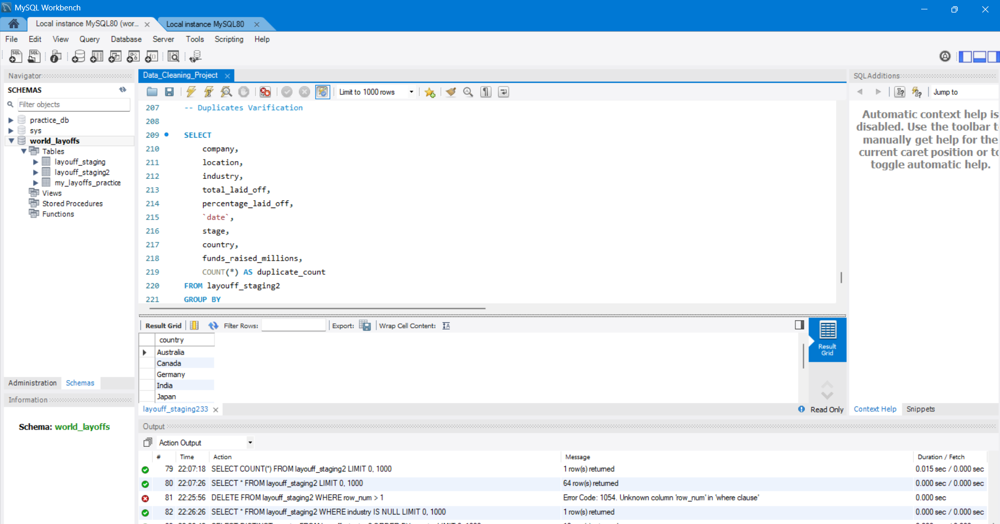
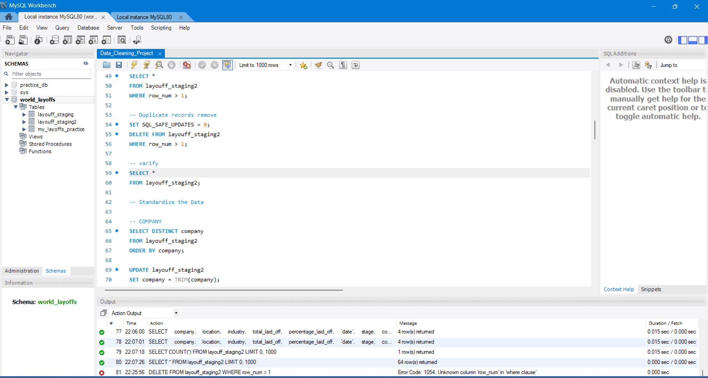
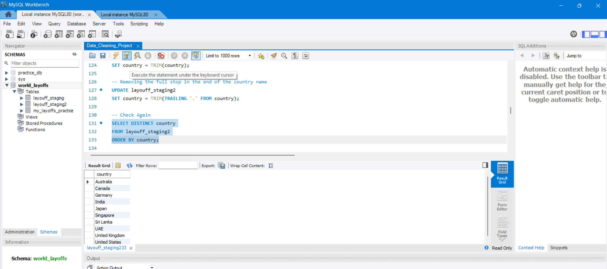
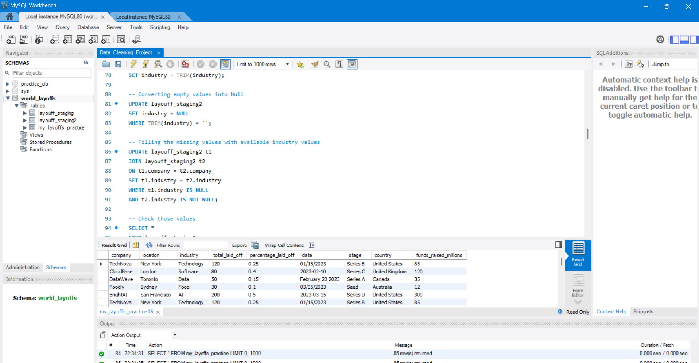
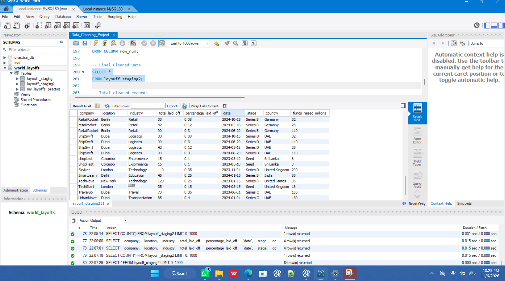

# MySQL Data Cleaning Project

## Project Overview
This project focuses on cleaning and preparing a real-world layoffs dataset using MySQL. The goal is to improve data quality and prepare the dataset for further analysis.

## Tools
- MySQL
- MySQL Workbench
- SQL

## Dataset
`my_layoffs_practice.csv` — the raw layoffs dataset used for the cleaning exercise.

## Data Cleaning Workflow
1. Created staging tables to preserve the source data.
2. Identified and removed duplicate records using `ROW_NUMBER()`.
3. Standardized text fields and handled inconsistent values.
4. Reviewed NULL and blank values.
5. Standardized date formats and converted the date column.
6. Removed an unnecessary helper column and checked the final cleaned data.

## SQL Skills Demonstrated
- CREATE TABLE, INSERT, ALTER TABLE
- Common Table Expressions (CTEs)
- Window functions (`ROW_NUMBER()`)
- UPDATE and DELETE
- TRIM(), CASE, REGEXP and STR_TO_DATE()
- JOIN, GROUP BY and HAVING

## Project Files
- [SQL data cleaning script](Data_Cleaning_Project.sql)
- [Raw dataset](my_layoffs_practice.csv)

## Screenshots

### SQL Queries

### Duplicate Verification

### Data Standardization

### NULL Value Checks

### Final Cleaned Data

## Learning Outcomes
- Practised a structured SQL data-cleaning workflow.
- Learned to identify duplicates and inconsistent values.
- Worked with missing values and date conversion.
- Prepared a dataset for exploratory data analysis.

## Learning Reference
Alex The Analyst — MySQL Data Cleaning Project. This repository project is a learning and portfolio exercise.
